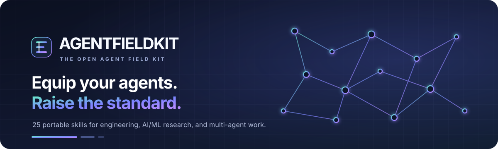

<div align="center">
  
  <h1>AgentFieldkit</h1>
  <p><strong>Equip your agents. Raise the standard.</strong></p>
  <p>An open-source field kit of 25 evidence-first workflows for software engineering, security, AI/ML research, and multi-agent collaboration.</p>
  <p>
    <a href="https://github.com/voyager67/agent-fieldkit/stargazers"></a>
    <a href="https://github.com/voyager67/agent-fieldkit/network/members"></a>
    <a href="LICENSE"></a>
    <a href=".github/workflows/validate-skills.yml"></a>
    
  </p>
  <p>
    <a href="#quick-start"><strong>Get started</strong></a> ·
    <a href="#the-skill-library">Explore the skills</a> ·
    <a href="CONTRIBUTING.md">Contribute</a> ·
    <a href="https://github.com/voyager67/agent-fieldkit/issues">Request a skill</a>
  </p>
</div>

---

## Code is easy to generate. Reliable work takes a process.

AI agents can produce convincing code while missing edge cases, skipping verification, or presenting assumptions as facts. **AgentFieldkit turns common engineering and AI research tasks into repeatable workflows with explicit checks and useful deliverables.**

Use a skill to give your agent a better process for the job—not another giant prompt to paste into every conversation.

<table>
  <tr>
    <td width="33%" valign="top">
      <h3>Evidence over confidence</h3>
      Every workflow distinguishes what was checked, what passed, what remains uncertain, and what still needs human review.
    </td>
    <td width="33%" valign="top">
      <h3>Engineering + AI research</h3>
      Move from repo exploration and code review to dataset hygiene, experiment tracking, model evaluation, and research evidence.
    </td>
    <td width="33%" valign="top">
      <h3>Portable by design</h3>
      Plain Markdown `SKILL.md` files, standard-library tooling, individual ZIP exports, and no required vendor API.
    </td>
  </tr>
</table>

## The AgentFieldkit workflow

```text
UNDERSTAND  →  PLAN  →  CHANGE  →  VERIFY  →  REPORT
     ↑                                    ↓
     └──────────── evidence loop ─────────┘
```

- **Understand the actual context.** Inspect the repository, data, constraints, and existing behavior before proposing changes.
- **Plan a testable outcome.** Turn vague requests into specific acceptance criteria and a small, reviewable plan.
- **Make the smallest useful change.** Keep edits focused and preserve existing behavior unless the task requires otherwise.
- **Verify with real evidence.** Run relevant checks and report exact results; do not claim tests passed if they were not run.
- **Leave a handoff people can trust.** Summarize the outcome, trade-offs, uncertainty, and the next action.

> **Safety rule:** a skill guides the agent; it does not grant new permissions. Publishing, deploying, merging, destructive operations, spending, or transmitting sensitive data still requires appropriate authorization.

## The skill library

**25 focused skills. One consistent quality bar.** Each link opens the actual `SKILL.md` playbook.

<details open>
<summary><strong>Build, debug & ship software · 10 skills</strong></summary>

| Skill | What it helps with |
|---|---|
| [`repo-scout`](skills/repo-scout/SKILL.md) | Map an unfamiliar codebase before touching it. |
| [`spec-first`](skills/spec-first/SKILL.md) | Turn a request into acceptance criteria and an implementation plan. |
| [`test-driven-change`](skills/test-driven-change/SKILL.md) | Build a behavior change around meaningful regression tests. |
| [`failure-forensics`](skills/failure-forensics/SKILL.md) | Reproduce a failure, isolate the cause, and verify the fix. |
| [`review-lens`](skills/review-lens/SKILL.md) | Review a diff for actionable correctness and maintainability risks. |
| [`api-contract-check`](skills/api-contract-check/SKILL.md) | Catch breaking changes in APIs, schemas, and serialized data. |
| [`docs-sync`](skills/docs-sync/SKILL.md) | Keep documentation and examples aligned with real behavior. |
| [`safe-migration`](skills/safe-migration/SKILL.md) | Plan a migration with validation and a rollback path. |
| [`build-rescue`](skills/build-rescue/SKILL.md) | Diagnose a failing build or CI run from the actual logs. |
| [`release-readiness`](skills/release-readiness/SKILL.md) | Check release evidence, risks, and outstanding blockers. |

</details>

<details open>
<summary><strong>Security, reliability & data integrity · 4 skills</strong></summary>

| Skill | What it helps with |
|---|---|
| [`security-surface`](skills/security-surface/SKILL.md) | Examine trust boundaries, auth, secrets, inputs, and exposed surfaces. |
| [`dependency-care`](skills/dependency-care/SKILL.md) | Evaluate dependency risk and upgrades without blind version bumps. |
| [`performance-proof`](skills/performance-proof/SKILL.md) | Find a measured bottleneck before optimizing. |
| [`sql-integrity-check`](skills/sql-integrity-check/SKILL.md) | Check query correctness, access scope, parameterization, and cost. |

</details>

<details open>
<summary><strong>AI/ML, datasets & research · 6 skills</strong></summary>

| Skill | What it helps with |
|---|---|
| [`data-quality-gate`](skills/data-quality-gate/SKILL.md) | Define validation gates for structured data and pipelines. |
| [`dataset-workshop`](skills/dataset-workshop/SKILL.md) | Prepare consistent, traceable SFT and evaluation datasets. |
| [`experiment-ledger`](skills/experiment-ledger/SKILL.md) | Make training runs, configurations, and comparisons reproducible. |
| [`model-eval-design`](skills/model-eval-design/SKILL.md) | Build evaluations that test capabilities rather than cherry-picked examples. |
| [`model-diff-review`](skills/model-diff-review/SKILL.md) | Compare checkpoints or prompt configurations using a shared protocol. |
| [`research-evidence-map`](skills/research-evidence-map/SKILL.md) | Organize sources, uncertainty, claims, and next experiments. |

</details>

<details open>
<summary><strong>Multi-agent teamwork · 4 skills</strong></summary>

| Skill | What it helps with |
|---|---|
| [`context-handoff`](skills/context-handoff/SKILL.md) | Pass actionable context between sessions, people, and agents. |
| [`multi-agent-crosscheck`](skills/multi-agent-crosscheck/SKILL.md) | Invite independent challenge and reconcile disagreement with evidence. |
| [`change-narrative`](skills/change-narrative/SKILL.md) | Explain a change through impact, trade-offs, and verification. |
| [`parallel-task-design`](skills/parallel-task-design/SKILL.md) | Split work into independent units with clear ownership and integration points. |

</details>

<details open>
<summary><strong>Skill quality & maintenance · 1 skill</strong></summary>

| Skill | What it helps with |
|---|---|
| [`agent-skill-audit`](skills/agent-skill-audit/SKILL.md) | Audit metadata, naming, duplication, portability, and risky instructions. |

</details>

Browse the machine-readable [`skills-index.json`](skills-index.json) or inspect the full [`skills/`](skills/) directory.

## Quick start

### 1. Get AgentFieldkit

```bash
git clone https://github.com/voyager67/agent-fieldkit.git
cd agent-fieldkit
```

Requires **Python 3.10+**. The validator, installer, and ZIP packager use only Python's standard library.

### 2. Validate the library

```bash
python scripts/validate_skills.py
python -m unittest discover -s tests -v
```

### 3. Install the skills you need

Install all skills for Codex:

```bash
python scripts/install_skills.py --agent codex --scope user
```

Or choose a different agent:

```bash
# Claude Code
python scripts/install_skills.py --agent claude --scope user

# Cursor
python scripts/install_skills.py --agent cursor --scope user

# Gemini CLI
python scripts/install_skills.py --agent gemini --scope user

# GitHub Copilot
python scripts/install_skills.py --agent copilot --scope user
```

Install one skill, preview changes first, or install into a project:

```bash
python scripts/install_skills.py --agent codex --scope user --skill failure-forensics --dry-run
python scripts/install_skills.py --agent codex --scope project
```

The installer **does not overwrite existing skills by default**. Review the printed destination first; pass `--overwrite` only when replacing those files is intentional. Use `--destination PATH` for another compatible host's documented skills directory.

## Use AgentFieldkit with different agents

AgentFieldkit keeps the skill content portable and adapts the install path where a local directory-based workflow is available. Host capabilities and discovery behavior can vary by product, plan, and version.

| Agent / product | Setup | Distribution path |
|---|---|---|
| **Claude Code** | `--agent claude` | User: `~/.claude/skills/` · Project: `.claude/skills/` |
| **Codex** | `--agent codex` | User: `~/.agents/skills/` · Project: `.agents/skills/` |
| **Cursor** | `--agent cursor` | Shared skills directory: `~/.agents/skills/` or `.agents/skills/` |
| **Gemini CLI** | `--agent gemini` | Shared skills directory: `~/.agents/skills/` or `.agents/skills/` |
| **GitHub Copilot** | `--agent copilot` | User: `~/.copilot/skills/` · Project: `.github/skills/` |
| **ChatGPT Skills** | ZIP export below | Import an individual skill ZIP through the available Skills interface |
| **Claude web Skills** | ZIP export below | Upload an individual skill ZIP through Claude's Skills settings |
| **Other compatible hosts** | `--agent generic --destination PATH` | Use the host's documented skill directory and verify its discovery rules |

### Export individual skill ZIPs for ChatGPT or Claude web

```bash
# Creates dist/chatgpt/<skill-name>.zip for every skill
python scripts/package_chatgpt.py --target chatgpt

# Creates dist/claude/<skill-name>.zip for every skill
python scripts/package_chatgpt.py --target claude

# Export just one skill
python scripts/package_chatgpt.py --target chatgpt --skill dataset-workshop
```

These commands prepare ZIP files; they do **not** upload skills to an account automatically. Availability and import steps depend on the target product's current interface and plan.

## Built for practical work

<table>
  <tr>
    <td valign="top" width="50%">
      <h3>Software teams</h3>
      <ul>
        <li>Explore unfamiliar code with less guesswork</li>
        <li>Turn requests into measurable acceptance criteria</li>
        <li>Debug from evidence, not intuition alone</li>
        <li>Review changes for security and compatibility</li>
        <li>Ship with explicit verification and rollback notes</li>
      </ul>
    </td>
    <td valign="top" width="50%">
      <h3>AI/ML builders & researchers</h3>
      <ul>
        <li>Standardize dataset cleaning and provenance</li>
        <li>Protect evaluation splits from leakage</li>
        <li>Track training configs and reproducibility details</li>
        <li>Compare models with consistent evaluation protocols</li>
        <li>Separate research evidence from assumptions</li>
      </ul>
    </td>
  </tr>
</table>

## Quality checks included

Every contribution is checked in CI for skill metadata, folder naming, instruction bodies, helper behavior, and ZIP packaging. Run the same checks locally before opening a pull request:

```bash
python scripts/validate_skills.py
python -m unittest discover -s tests -v
python scripts/package_chatgpt.py --target chatgpt --output /tmp/agent-fieldkit-chatgpt-packages
python scripts/package_chatgpt.py --target claude --output /tmp/agent-fieldkit-claude-packages
```

The validator is intentionally lightweight; it is not a full YAML implementation or a guarantee of identical behavior across every agent host.

## Help shape the library

AgentFieldkit is most useful when its skills reflect real problems and lessons from real projects. Contributions are welcome:

- **Suggest a skill** for a task you repeat with an agent.
- **Improve a workflow** with clearer triggers, stronger checks, or a better output contract.
- **Add tests** for installer edge cases, portability, and packaging.
- **Report a compatibility issue** with the exact host, environment, and reproduction steps.

Read [`CONTRIBUTING.md`](CONTRIBUTING.md) before opening a pull request. Use the issue templates to propose improvements or report problems. Useful, focused contributions beat adding skills just to increase the count.

**Found it useful?** Star the repository to help more developers discover it, and share the workflow that saved you the most time.

## Design principles

1. **Specific beats vague.** Skills define when to trigger and what a useful result looks like.
2. **Evidence beats confidence.** Checks and findings should be traceable to actual output or sources.
3. **Small changes beat uncontrolled rewrites.** Preserve context and reduce regression surface.
4. **Uncertainty is part of the report.** Distinguish verified facts, assumptions, and open questions.
5. **Safety is explicit.** Skills do not authorize destructive work or external disclosure by default.
6. **The human stays in control.** Important decisions, risky changes, and external side effects need appropriate review.

## Documentation

- [Agent Skills specification](https://agentskills.io/specification)
- [ChatGPT — Build skills](https://learn.chatgpt.com/docs/build-skills)
- [Claude Agent Skills](https://platform.claude.com/docs/en/agents-and-tools/agent-skills/overview)
- [GitHub Copilot agent skills](https://docs.github.com/en/copilot/concepts/customizations/agent-skills)
- [Cursor skills](https://cursor.com/docs/skills)
- [Gemini CLI skills](https://github.com/google-gemini/gemini-cli/blob/main/docs/cli/skills.md)

## License & independence

AgentFieldkit is released under the [MIT License](LICENSE). The skills and tooling in this repository were written for AgentFieldkit and are not copied skill files from another repository. AgentFieldkit is an independent community project and is not affiliated with Anthropic, OpenAI, GitHub, Google, Cursor, or any other agent provider. Product names are used only to describe interoperability.

<div align="center">
  <hr />
  <sub><strong>AgentFieldkit</strong> · Equip your agents. Raise the standard.</sub>
</div>
<p align="center">
  <a href="https://github.com/voyager67/AgentFieldkit/stargazers">
    
  </a>
  <a href="https://github.com/voyager67/AgentFieldkit/network/members">
    
  </a>
  <a href="https://github.com/voyager67/AgentFieldkit/blob/main/LICENSE">
    
  </a>
  
</p>
